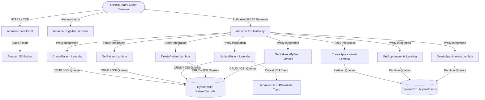
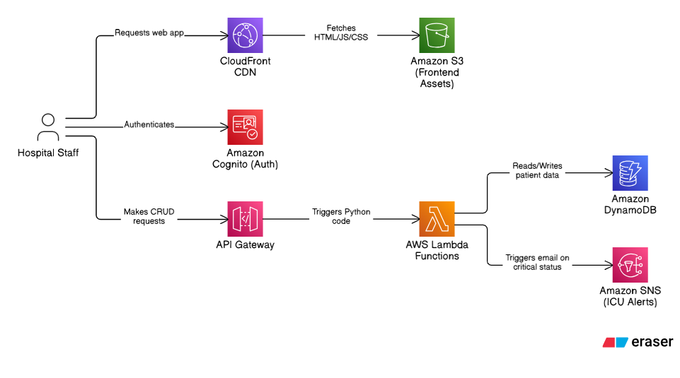

# Riverside General Hospital — Serverless Patient Records System


An enterprise-grade, highly available, and secure serverless healthcare management system built on Amazon Web Services (AWS) to manage inpatient records, scheduling, and clinical ward assignments for Riverside General Hospital.

---

## System Architecture

The solution implements a fully decoupled, multi-tier cloud-native architecture adhering to AWS Well-Architected Framework best practices:





### Architectural Components
* **Edge & Delivery:** Amazon CloudFront providing TLS 1.3 encryption, DDoS mitigation, and global asset caching.
* **Storage:** Amazon S3 configured for private origin access and static single-page application (SPA) hosting.
* **Identity & Access Management:** Amazon Cognito User Pool managing staff authentication, OAuth 2.0 authorization code grant flow, and JWT token issuance.
* **API Routing:** Amazon API Gateway RESTful endpoints with CORS policy enforcement, payload validation, and Lambda proxy integration.
* **Compute Tier:** AWS Lambda microservices executed on Python 3.13 (`arm64`), implementing discrete business logic and least-privilege IAM policies.
* **Persistence Tier:** Amazon DynamoDB NoSQL tables utilizing Global Secondary Indexes (GSI `ward-index`) for sub-millisecond query performance.
* **Notification System:** Amazon SNS triggering urgent dispatch alerts upon ICU patient status transfer.

---

## Core Capabilities

* **Federated Single Sign-On (SSO):** Managed authentication gate via Amazon Cognito Hosted UI enforcing JWT-based access controls across all clinical routes.
* **Complete Clinical CRUD Engine:**
  * **Admission & Registration:** Ingest patient intake records with schema verification.
  * **Search & Retrieval:** Direct primary key lookups and GSI ward-partitioned queries.
  * **Clinical Updates:** Real-time attribute modification with automatic audit timestamping (`updatedAt`).
  * **Discharge Management:** Secure patient record removal upon formal discharge.
* **Appointment Scheduling Module:** Sub-resource routing (`/patients/{id}/appointments`) enabling scheduling, listing, and cancellation with double-booking prevention.
* **Ward Census Dashboard:** Operational dashboard aggregating live patient counts and statuses across hospital wards (ICU, Maternity, Paediatrics, Surgical, General).
* **HIPAA Compliance Considerations:** Least-privilege IAM policies, role-based access control, zero plain-text PHI in CloudWatch logs, and complete transit encryption.

---

## Repository Structure

```text
healthcare-starter-code/
├── frontend/                     # Client application (Vanilla JS SPA)
│   ├── index.html                # Application structure & modal layouts
│   ├── styles.css                # Enterprise clinical design system
│   └── app.js                    # Cognito auth flow, DOM state & API client
├── lambda/                       # Serverless microservice handlers
│   ├── CreateAppointment.py      # POST /patients/{id}/appointments
│   ├── CreatePatient.py          # POST /patients
│   ├── DeleteAppointment.py      # DELETE /patients/{id}/appointments/{date}
│   ├── DeletePatient.py          # DELETE /patients/{id}
│   ├── GetAppointments.py        # GET /patients/{id}/appointments
│   ├── GetPatient.py             # GET /patients/{id}
│   ├── GetPatientsByWard.py      # GET /wards/{ward}/patients
│   └── UpdatePatient.py          # PUT /patients/{id}
├── policies/                     # Least-privilege IAM JSON policy documents
│   ├── dynamodb-index-access-policy.json
│   ├── lambda-table-access-policy.json
│   ├── s3-bucket-policy.json
│   └── sns-icu-publish-policy.json
├── tests/                        # Validation suites & integration mocks
│   ├── lambda-test-events/       # Synthetic event payloads for Lambda testing
│   ├── sample-data.json          # Standardized patient seed records
│   ├── api-tests.sh              # Automated cURL integration test suite
│   └── test-appointments.ps1     # PowerShell integration test script
└── assets/                       # Technical diagrams and validation artifacts
```

---

## Deployment & Provisioning Guide

### 1. Persistence & Compute Tier
1. Provision a DynamoDB table named `PatientRecords` with partition key `patientId` (String).
2. Create a Global Secondary Index (GSI) named `ward-index` with partition key `ward` (String).
3. Provision an additional DynamoDB table named `Appointments` with partition key `patientId` (String) and sort key `appointmentDate` (String).
4. Deploy the 8 Python Lambda functions from `lambda/`, attaching execution roles configured via `policies/lambda-table-access-policy.json` and `policies/dynamodb-index-access-policy.json`.

### 2. API Gateway Configuration
1. Deploy an Amazon API Gateway REST API.
2. Configure resources (`/patients`, `/patients/{patientId}`, `/patients/{patientId}/appointments`, `/wards/{ward}/patients`) with corresponding HTTP verbs.
3. Attach Lambda Proxy Integrations, enable CORS with appropriate origin headers, and deploy to stage `prod`.

### 3. Identity & Web Tier
1. Configure an Amazon Cognito User Pool and App Client supporting OAuth 2.0 Authorization Code Grant.
2. In `frontend/app.js`, configure `API_BASE_URL`, `COGNITO_DOMAIN`, `CLIENT_ID`, and `REDIRECT_URI`.
3. Sync `frontend/` assets to an Amazon S3 bucket fronted by an Amazon CloudFront distribution.
4. Set CloudFront origin domain as the Allowed Callback & Sign-out URL in Cognito.

---

## Verification & Testing

Execute the automated integration test suite to validate all API Gateway endpoints:

```bash
chmod +x tests/api-tests.sh
./tests/api-tests.sh
```

Alternatively, execute the PowerShell appointment validation script:

```powershell
./tests/test-appointments.ps1
```
